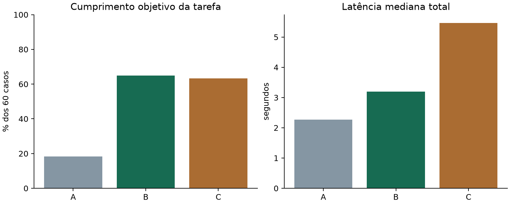

# Relatório — Guia de Mobilidade Acessível

## 1. Integrantes

Cassio Valezzi — RM551059; Gabriel Antony Cadima Ciziks — RM98215; Lucca Sabatini Tambellini — RM98169; Victor Nuzzi — RM98209.

## 2. Ficha técnica e tarefa

Guia documental local sobre mobilidade acessível em São Paulo. Perguntas livres sobre Atende+, Bilhete Único Especial PcD, atendimento e sanitários do Metrô e arts. 46–52 da LBI. Não decide benefícios individuais nem consulta estado em tempo real. O contrato distingue respondido, parcial, nao_consta, fora_escopo e indisponivel.

## 3. Pipeline documental e IA

Coleta HTTPS validada, snapshots integrais locais ignorados, curadoria factual atribuída, trechos com proveniência e embeddings multilingual-e5-small CPU normalizados. B faz uma busca top3; C usa o mesmo recuperador e modelo, escolhendo search/read_chunk/finalizar, até quatro ferramentas e uma geração final (um reparo no máximo), 90 segundos. O baseline A recebe somente política e pergunta e pode usar conhecimento prévio. Qwen3-4B-Instruct-2507 Q4_K_M, llama.cpp b12287 CUDA12.4, temperatura0, seed42, contexto8192. SHA-256: `3605803b982cb64aead44f6c1b2ae36e3acdb41d8e46c8a94c6533bc4c67e597`.

O produto exibe extratos conferidos, sem certificar a prosa livre do modelo. Para recusas, a entrega usa mensagem segura fixa do status escolhido pela LLM, descartando prosa factual e anexos; bruto preservado, tratamento comum a A/B/C. Validade textual não prova relevância: unidades, condições, grupos documentais e conclusões proibidas são avaliados separadamente. Gabaritos e regras foram conferidos documentalmente com revisão assistida por IA; não se alega revisão humana. Padrões explícitos de equivalência podem produzir falsos negativos e não auditam toda afirmação livre. Alucinação não avaliável é null, nunca zero presumido.

## 4. Base e partições

114 trechos; 7 fontes oficiais. Partições de 20 desenvolvimento, 20 validação e 60 teste por grupo semântico. Catálogo separado dos gabaritos. Sínteses próprias são identificadas como curated_summary. Snapshots integrais informativos não são redistribuídos como licença aberta.

| Fonte | Órgão | Trechos |
|---|---|---:|
| [F01](https://www.sptrans.com.br/atende/) — Atende+ | SPTrans | 2 |
| [F02](https://www.sptrans.com.br/atende/sobre-o-atende) — Sobre o Atende+ | SPTrans | 4 |
| [F03](https://www.sptrans.com.br/perguntas-e-respostas/?sobre=atende) — Perguntas e respostas — Atende+ | SPTrans | 24 |
| [F04](https://www.sptrans.com.br/perguntas-e-respostas/?sobre=bilhete-pcd) — Perguntas e respostas — Bilhete Único Especial PcD | SPTrans | 32 |
| [F05](https://www.metro.sp.gov.br/sua-viagem/acessibilidade/atendimento-preferencial/) — Atendimento preferencial | Metrô de São Paulo | 3 |
| [F06](https://www.metro.sp.gov.br/sua-viagem/acessibilidade/sanitario-publico/) — Sanitários públicos | Metrô de São Paulo | 42 |
| [F07](https://www2.camara.leg.br/legin/fed/lei/2015/lei-13146-6-julho-2015-781174-normaatualizada-pl.pdf) — Lei Brasileira de Inclusão — Lei13.146/2015, arts46–52 | Câmara dos Deputados | 7 |

## 5. Performance e configurações

Rodada `20261112T061006Z-teste`: 180 consultas medidas (60 por configuração), 372 chamadas LLM; aquecimento salvo fora do placar. Entradas iguais durante a rodada: True. Padrão escolhido em validação: **B**, limiar **0.85**. Critério e resultados em avaliacao/calibracao. Sem ajustes de prompt a partir do teste final.

| Config. | Acerto global | Acerto respondíveis | Parcial | Recusa correta | JSON bruto | JSON entregue | Citações suficientes | Mediana/p95(s) | Chamadas |
|---|---|---|---|---|---|---|---|---|---:|
| A | 11/60 | 0/40 | 0/60 | 11/20 | 60/60 | 60/60 | N/A (0 avaliáveis) | 2.27/9.47 | 81 |
| B | 39/60 | 24/40 | 12/60 | 15/20 | 60/60 | 60/60 | 32/40 | 3.20/6.83 | 60 |
| C | 38/60 | 26/40 | 7/60 | 12/20 | 60/60 | 60/60 | 31/40 | 5.47/10.17 | 231 |

p95: posto ceil(0,95 × n). Coberturas somam frações por pergunta; denominadores indicam perguntas avaliáveis. Recuperação não se aplica a A nem a negativos sem gold. Recusa correta usa apenas negativos; indisponível é falha técnica.

| Config. | Recall@1 | Recall@3 | Após filtro | Acumulado | Alucinação bruta | Alucinação entregue | Recusa indevida | Falha técnica |
|---|---|---|---|---|---|---|---|---|
| A | N/A (0 avaliáveis) | N/A (0 avaliáveis) | N/A (0 avaliáveis) | N/A (0 avaliáveis) | N/A (0 avaliáveis) | N/A (0 avaliáveis) | 23/40 | 15/60 |
| B | 29.5/40 | 35/40 | 35/40 | 35/40 | N/A (0 avaliáveis) | 0/47 | 1/40 | 0/60 |
| C | 19/40 | 32/40 | 32/40 | 32/40 | N/A (0 avaliáveis) | 0/43 | 3/40 | 0/60 |

A primeira validação e seus inputs foram preservados; os refinamentos de contrato/escopo ocorreram antes do teste final. A comparação preserva erros e conhecimento prévio do baseline. Acertos por padrões documentais são estimativas conservadoras. Não se afirma redução de alucinação quando os denominadores auditáveis diferem. O agente adiciona custo e pode falhar por escolher busca estreita, finalizar cedo ou acumular contexto insuficiente. Categorias completas estão em summary.json e nos notebooks.

Comparação pareada do critério objetivo: B teve 39/60 casos completos, A 11/60 e C 38/60. A diferença B−A foi 46.7 pontos percentuais; C−B foi -1.7. A mediana de C foi 1.71 vezes a de B. São resultados desta amostra, sem intervalo de confiança ou garantia de generalização. Falhas de contrato contam como falha de tarefa, sem provar ausência de conhecimento factual.

Metas iniciais confrontadas com o teste, sem alterar os critérios: recall@3: 87.5% / meta 90% (não atingida); acerto respondível B: 60.0% / meta 80% (não atingida); recusa correta B: 75.0% / meta 90% (não atingida); JSON entregue B: 100.0% / meta 98% (atingida).

O denominador 40 de answerable_success inclui 35 perguntas integralmente cobertas e cinco parcialmente cobertas. Acerto completo nesses casos parciais exige responder à parte coberta e delimitar corretamente a lacuna. A coluna Parcial conta alguma unidade correta em uma tarefa que não foi totalmente cumprida, entre todos os 60 casos; não equivale aos cinco casos cuja cobertura esperada é parcial.

| Config. | Simples | Compostas | Parcial esperado | Sem cobertura | Fora/adversariais | Estritamente respondíveis |
|---|---|---|---|---|---|---|
| A | 0/25 | 0/10 | 0/5 | 6/15 | 5/5 | 0/35 |
| B | 20/25 | 3/10 | 1/5 | 10/15 | 5/5 | 23/35 |
| C | 18/25 | 6/10 | 2/5 | 7/15 | 5/5 | 24/35 |

Auditoria semântica posterior pela mesma Qwen local, identificada como IA e sujeita a viés de autoavaliação. Tempos e tokens do juiz não entram no placar medido. Campos null e falhas permanecem não avaliáveis. Divergências com critérios objetivos ficam preservadas.

| Config. | Sucesso entregue (juiz) | Alucinação bruta (juiz) | Alucinação entregue (juiz) | Falhas do juiz |
|---|---|---|---|---:|
| A | 9/60 | 34/43 | 39/49 | 0 |
| B | 40/60 | 0/47 | 1/49 | 0 |
| C | 37/60 | 5/45 | 6/46 | 0 |

## 6. Cinco erros reais e correções propostas

### Erro 1: A / T03 — Sem contexto, o modelo inventou uma regra de edital e uma transcrição atribuída ao art.46, além de preencher evidence com ID não recebido. O único reparo não resolveu o contrato; a entrega tornou-se indisponivel. Causa provável: combinação de conhecimento gerado sem suporte e baixa adesão à exigência evidence=[] do baseline, não indisponibilidade do servidor.

Revisão documental: A fonte SPTrans F04, pergunta 24141, conta até 20 dias da aprovação. A saída bruta afirma início em publicação de edital/notificação e atribui ao art.46 uma redação que não é a norma coletada. O art.46 trata de igualdade e acessibilidade, não desse prazo de entrega. O ID art_46_lbi não existe no corpus nem foi visto; seen está vazio. Há erro factual bruto e falha real de contrato após reparo. A entrega indisponivel é falha técnica de tarefa; não é recusa correta nem afirmação pública de prazo.

Fontes do gabarito:
- [F04-faq-24141](https://www.sptrans.com.br/perguntas-e-respostas/?sobre=bilhete-pcd) — #pergunta_24141 — Qual o prazo para entrega do Bilhete Único?: A previsão de entrega do Bilhete Especial PcD é de até 20 dias a partir da aprovação da solicitação, não a partir do primeiro cadastro.

Contexto visto:
- Nenhum trecho consultado.

Primeira saída bruta (preservada):

~~~json
{
  "status": "respondido",
  "answer": "O prazo publicado de entrega do Bilhete Único Especial PcD começa a ser contado a partir da data de publicação do edital ou da notificação oficial no site do Sistema de Transporte Metropolitano de São Paulo (SMTSP) ou no portal do Atende+, conforme previsto na Lei Brasileira de Inclusão (LBI), artigo 46, que estabelece o direito de acesso ao transporte público por pessoas com deficiência. O prazo é calculado a partir da data de publicação do edital de oferta do bilhete, e não a partir de uma data específica de entrega física ou de solicitação individual.",
  "evidence": [
    {
      "chunk_id": "art_46_lbi",
      "quote": "Art. 46. A pessoa com deficiência tem direito de acesso ao transporte público, mediante a utilização de meios de transporte acessíveis, com a possibilidade de obtenção de bilhetes especiais, conforme estabelecido no presente artigo e nos demais dispositivos da Lei Brasileira de Inclusão."
    }
  ],
  "missing_information": [],
  "refusal_reason": null
}
~~~

A partir de quando é contado o prazo publicado de entrega do Bilhete Especial PcD?

Esperado: respondido. Unidades: Até 20 dias

Entregue: indisponivel — Não foi possível concluir a consulta. Tente novamente.

Auditoria: status 'indisponivel'; esperado respondido; unidades ausentes: 1; condições ausentes: 1

Causa provável: Sem contexto, o modelo inventou uma regra de edital e uma transcrição atribuída ao art.46, além de preencher evidence com ID não recebido. O único reparo não resolveu o contrato; a entrega tornou-se indisponivel. Causa provável: combinação de conhecimento gerado sem suporte e baixa adesão à exigência evidence=[] do baseline, não indisponibilidade do servidor.. Correção proposta: Em versão futura, impor evidence=[] estruturalmente no schema de A e no reparo, preservando liberdade para responder ou reconhecer incerteza. Auditar a prosa separadamente. Medir em novo conjunto independente; não recalcular o placar desta rodada. Preservar esta rodada e exigir novo teste independente antes de alegar ganho.

Contexto, saída bruta, gabarito, condições e fontes completos: `avaliacao/erros_reais.json`, item 1; rodada `20261112T061006Z-teste`.

### Erro 2: B / T01 — A única busca top3 trouxe nome social, atraso de entrega e renovação, deixando de fora a FAQ sobre comparecimento pessoal. O modelo usou extratos desses três assuntos como uma resposta parcial, embora nenhum respondesse à possibilidade de representação no cadastramento. Causa provável: similaridade semântica dominada por termos genéricos de Bilhete/posto/cadastro e ausência de verificação de pertinência antes da entrega.

Revisão documental: A FAQ24139 orienta comparecimento pessoal do interessado ao posto com documentação. Esse é o trecho ouro F04-faq-24139, ausente do top3 e de seen. As citações entregues são íntegras, mas tratam de nome social, não recebimento e renovação. Logo, não respondem sequer a uma parte material da pergunta de representação; parcial não é justificado por esses extratos. O erro não depende de correspondência lexical do avaliador.

Fontes do gabarito:
- [F04-faq-24139](https://www.sptrans.com.br/perguntas-e-respostas/?sobre=bilhete-pcd) — #pergunta_24139 — É possível enviar um representante ao Posto de Atendimento - Bilhete Único Especial para fazer o cadastramento em nome da pessoa com deficiência?: Para cadastramento presencial do Bilhete Especial PcD, a FAQ orienta o comparecimento pessoal do interessado ao posto com a documentação necessária.

Contexto visto:
- F04-faq-24145: O nome social pode ser solicitado para o Bilhete Especial PcD no Atendimento Digital SPTrans, em Meu Perfil, Meus Dados, no campo correspondente. A FAQ cita o Decreto Municipal 58.228/2018.
- F04-faq-24147: Se o Bilhete Especial PcD não chegar em 20 dias, informe o não recebimento no Atendimento SPTrans ou em posto. Pode haver reenvio ao endereço cadastrado ou retirada no Posto Central: Rua Boa Vista, 274, mezanino, Centro, São Paulo, de segunda a sexta, das 8h às 17h, exceto feriados.
- F04-faq-24155: A renovação do Bilhete Especial PcD pode ser solicitada até 60 dias antes do vencimento, em posto ou no Atendimento Digital, com documentação necessária. Para deficiência permanente, exames, laudos e documentos complementares são exigidos na primeira via e não na renovação.

Primeira saída bruta (preservada):

~~~json
{"status":"parcial","answer":"Os trechos consultados não mencionam se é possível substituir o interessado por um representante no cadastro do Bilhete Único Especial PcD em posto. A informação sobre representação não está presente nas fontes disponibilizadas.","evidence":[{"chunk_id":"F04-faq-24145","quote":"O nome social pode ser solicitado para o Bilhete Especial PcD no Atendimento Digital SPTrans, em Meu Perfil, Meus Dados, no campo correspondente."},{"chunk_id":"F04-faq-24147","quote":"Se o Bilhete Especial PcD não chegar em 20 dias, informe o não recebimento no Atendimento SPTrans ou em posto. Pode haver reenvio ao endereço cadastrado ou retirada no Posto Central: Rua Boa Vista, 274, mezanino, Centro, São Paulo, de segunda a sexta, das 8h às 17h, exceto feriados."},{"chunk_id":"F04-faq-24155","quote":"A renovação do Bilhete Especial PcD pode ser solicitada até 60 dias antes do vencimento, em posto ou no Atendimento Digital, com documentação necessária. Para deficiência permanente, exames, laudos e documentos complementares são exigidos na primeira via e não na renovação."}],"missing_information":["possibilidade de representação legal ou física no cadastro do Bilhete Único Especial PcD em posto"],"refusal_reason":"A base documental consultada não contém informações sobre a substituição do interessado por um representante no cadastro do Bilhete Único Especial PcD."}
~~~

Para cadastrar o Bilhete Especial PcD no posto, o interessado pode ser substituído por um representante?

Esperado: respondido. Unidades: Comparecimento pessoal do interessado

Entregue: parcial — O nome social pode ser solicitado para o Bilhete Especial PcD no Atendimento Digital SPTrans, em Meu Perfil, Meus Dados, no campo correspondente.

Se o Bilhete Especial PcD não chegar em 20 dias, informe o não recebimento no Atendimento SPTrans ou em posto. Pode haver reenvio ao endereço cadastrado ou retirada no Posto Central: Rua Boa Vista, 274, mezanino, Centro, São Paulo, de segunda a sexta, das 8h às 17h, exceto feriados.

A renovação do Bilhete Especial PcD pode ser solicitada até 60 dias antes do vencimento, em posto ou no Atendimento Digital, com documentação necessária. Para deficiência permanente, exames, laudos e documentos complementares são exigidos na primeira via e não na renovação.

Auditoria: status 'parcial'; esperado respondido; unidades ausentes: 1; evidências não cobrem todos os grupos documentais necessários

Causa provável: A única busca top3 trouxe nome social, atraso de entrega e renovação, deixando de fora a FAQ sobre comparecimento pessoal. O modelo usou extratos desses três assuntos como uma resposta parcial, embora nenhum respondesse à possibilidade de representação no cadastramento. Causa provável: similaridade semântica dominada por termos genéricos de Bilhete/posto/cadastro e ausência de verificação de pertinência antes da entrega.. Correção proposta: Avaliar no desenvolvimento busca que preserve a intenção representação versus comparecimento pessoal e, se justificado, combinação lexical/densa compartilhada por B/C. Fazer guarda de suficiência por pergunta: não exibir trechos apenas relacionados como parte respondida. Validar em nova rodada independente. Preservar esta rodada e exigir novo teste independente antes de alegar ganho.

Contexto, saída bruta, gabarito, condições e fontes completos: `avaliacao/erros_reais.json`, item 2; rodada `20261112T061006Z-teste`.

### Erro 3: C / T33 — O agente fez duas buscas quase equivalentes sobre análise e entrega e leu o mesmo trecho de atraso de entrega duas vezes, gastando as quatro ferramentas sem recuperar os dois marcos temporais. A prosa bruta transformou a menção a 20 dias do atraso em prazo contado da solicitação. A extração removeu essa inferência, mas restou só orientação sobre não recebimento, insuficiente para comparar os prazos.

Revisão documental: F04-faq-69246 informa análise em até 20 dias após formulário e documentação médica obrigatória; F04-faq-24141 informa entrega em até 20 dias após aprovação. O agente viu F04-faq-24147, que trata de não recebimento, não define início do prazo. A frase bruta de entrega a partir da solicitação contraria a condição publicada de aprovação. Nenhum dos dois grupos ouro foi consultado, e o extrato entregue não compara os dois prazos. A renderização evitou publicar o marco incorreto, mas não recuperou o conteúdo ausente.

Fontes do gabarito:
- [F04-faq-69246](https://www.sptrans.com.br/perguntas-e-respostas/?sobre=bilhete-pcd) — #pergunta_69246 — Qual o prazo de análise da solicitação de Bilhete Único da Pessoa com Deficiência?: Após receber formulário preenchido e toda a documentação médica obrigatória, a equipe médica auditora SPTrans analisa a solicitação do Bilhete PcD em até 20 dias. Pode aprovar, reprovar, pedir complementos ou convocar auditoria presencial.
- [F04-faq-24141](https://www.sptrans.com.br/perguntas-e-respostas/?sobre=bilhete-pcd) — #pergunta_24141 — Qual o prazo para entrega do Bilhete Único?: A previsão de entrega do Bilhete Especial PcD é de até 20 dias a partir da aprovação da solicitação, não a partir do primeiro cadastro.

Contexto visto:
- F04-faq-24147: Se o Bilhete Especial PcD não chegar em 20 dias, informe o não recebimento no Atendimento SPTrans ou em posto. Pode haver reenvio ao endereço cadastrado ou retirada no Posto Central: Rua Boa Vista, 274, mezanino, Centro, São Paulo, de segunda a sexta, das 8h às 17h, exceto feriados.
- F04-faq-24137: Para solicitar o Bilhete Único Especial PcD, consulte documentos e exames exigidos e obtenha o formulário no Atendimento Digital SPTrans ou em posto. O médico deve preenchê-lo de modo legível, com identificação da patologia, limitações, assinatura, carimbo e data; o solicitante ou representante também assina. O formulário específico SPTrans vale 90 dias. Para deficiência permanente existe formulário oficial SMS próprio. A solicitação depende de análise e não garante aprovação.
- F04-faq-24159: Para bloquear Bilhete Especial PcD perdido, roubado, extraviado ou furtado em São Paulo, o titular deve procurar posto ou ligar 156, com atendimento 24 horas. Em outras cidades, a FAQ indica 0800 550 121 da CPTM, segunda a sexta das 5h às 22h e sábado das 6h às 18h. Após bloquear, a segunda via exige comparecer a posto com identificação, CPF se necessário e comprovante de residência de até seis meses.
- F04-faq-24138: A solicitação do Bilhete Especial PcD exige documento pessoal com foto, CPF se não constar nele, comprovante de residência de até seis meses e formulário SPTrans ou de laudo permanente SMS preenchido pelo médico. Exames, laudos e outros documentos são exigidos quando previstos no Anexo único de patologias.

Primeira saída bruta (preservada):

~~~json
{"status":"parcial","answer":"O prazo de entrega do Bilhete Único Especial PcD é de 20 dias a partir da solicitação. No entanto, o documento não especifica se o prazo de análise e o prazo de entrega começam no mesmo momento. A informação sobre o início simultâneo dos prazos não está presente nas fontes consultadas.","evidence":[{"chunk_id":"F04-faq-24147","quote":"Se o Bilhete Especial PcD não chegar em 20 dias, informe o não recebimento no Atendimento SPTrans ou em posto."}],"missing_information":["prazo de análise do Bilhete Único Especial PcD e se ele começa no mesmo momento que o prazo de entrega"],"refusal_reason":"A base documental consultada não informa o prazo de análise e não estabelece se ele começa no mesmo momento que o prazo de entrega."}
~~~

O prazo de análise do Bilhete PcD e o de entrega começam no mesmo momento? Quais são?

Esperado: respondido. Unidades: Análise até20dias após documentos obrigatórios; Entrega até20dias após aprovação

Entregue: parcial — Se o Bilhete Especial PcD não chegar em 20 dias, informe o não recebimento no Atendimento SPTrans ou em posto.

Auditoria: status 'parcial'; esperado respondido; unidades ausentes: 1, 2; evidências não cobrem todos os grupos documentais necessários

Causa provável: O agente fez duas buscas quase equivalentes sobre análise e entrega e leu o mesmo trecho de atraso de entrega duas vezes, gastando as quatro ferramentas sem recuperar os dois marcos temporais. A prosa bruta transformou a menção a 20 dias do atraso em prazo contado da solicitação. A extração removeu essa inferência, mas restou só orientação sobre não recebimento, insuficiente para comparar os prazos.. Correção proposta: Em versão futura, decompor perguntas compostas em fatos e marcos distintos, evitar leituras repetidas sem ganho e exigir fonte para a condição de início de cada prazo. Não inferir marco inicial a partir de regra de atraso. Avaliar o ajuste em novo teste independente, conservando os rastros atuais. Preservar esta rodada e exigir novo teste independente antes de alegar ganho.

Contexto, saída bruta, gabarito, condições e fontes completos: `avaliacao/erros_reais.json`, item 3; rodada `20261112T061006Z-teste`.

### Erro 4: C / T38 — O agente escolheu finish imediatamente, sem busca, tratando localização do sanitário e estoque atual de sabonete como um único tema fora do domínio. Causa provável: decisão prematura de escopo disparada pelo componente operacional ausente, sem reconhecer a unidade documental coberta.

Revisão documental: F06-sanitario-luz-1 localiza o sanitário da Luz no mezanino, área paga, e documenta horário usual 6h–22h. O corpus não fornece estoque atual de sabonete. Portanto a tarefa pede resposta parcial: localização coberta e estoque desconhecido. O rastro mostra finish na primeira ação e seen vazio; tanto a recusa total quanto a afirmação bruta de que a localização não está no escopo são incorretas. Não é um erro de sinonímia ou apenas de status abstrato: uma informação respondível deixou de ser entregue.

Fontes do gabarito:
- [F06-sanitario-luz-1](https://www.metro.sp.gov.br/sua-viagem/acessibilidade/sanitario-publico/) — Tabela Linha 1-Azul; estação LUZ: Sanitários na estação LUZ, Linha 1-Azul do Metrô. Local: Mezanino (Área Paga). Horário publicado: Todos os dias, das 6h às 22h. Administração: RZK. São informações documentais; não confirmam disponibilidade neste momento.

Contexto visto:
- Nenhum trecho consultado.

Primeira saída bruta (preservada):

~~~json
{"status":"fora_escopo","answer":"A pergunta refere-se a localização de um sanitário e disponibilidade de sabonete em um local específico (Luz), que não está dentro do escopo de informações sobre mobilidade acessível, transporte público ou instalações de serviços públicos em São Paulo.","evidence":[],"missing_information":[],"refusal_reason":"A pergunta envolve detalhes sobre instalações e itens de higiene em um local específico, que não estão abrangidos pelas regras e documentos de mobilidade acessível e transporte público mencionados."}
~~~

Onde fica o sanitário da Luz e há sabonete disponível agora?

Esperado: parcial. Unidades: Luz mezanino área paga

Entregue: fora_escopo — A solicitação está fora do escopo deste guia documental.

Auditoria: status 'fora_escopo'; esperado parcial; unidades ausentes: 1; evidências não cobrem todos os grupos documentais necessários

Causa provável: O agente escolheu finish imediatamente, sem busca, tratando localização do sanitário e estoque atual de sabonete como um único tema fora do domínio. Causa provável: decisão prematura de escopo disparada pelo componente operacional ausente, sem reconhecer a unidade documental coberta.. Correção proposta: Em versão futura, reconhecer a parte documental da pergunta composta e buscar sua evidência antes de recusar o restante. Entregar localização com status parcial e delimitar ausência de estoque atual, sem inventar telemetria. Conferir essa política em novo conjunto independente. Preservar esta rodada e exigir novo teste independente antes de alegar ganho.

Contexto, saída bruta, gabarito, condições e fontes completos: `avaliacao/erros_reais.json`, item 4; rodada `20261112T061006Z-teste`.

### Erro 5: C / T35 — Com ambos os trechos corretos já vistos, a prosa calculou incorretamente a diferença entre 4h40 e 6h como 1h40. Além disso, criou exigências de capacidade, posição de rampas e disponibilidade atual não solicitadas, rotulando como parcial uma comparação documental já coberta. A entrega extrativa retirou a conta, mas manteve status e lacunas indevidos.

Revisão documental: F06-sanitario-sao-bento-1 informa área paga e 4h40–0h; F06-sanitario-vila-madalena-2 informa terminal de ônibus e 6h–0h. A diferença entre os inícios é 80 minutos, isto é, 1h20, não 1h40 como afirma raw. As duas fontes foram consultadas e estão integralmente entregues, tornando possível comparar horários e áreas documentais. A conta falsa não foi apresentada no texto extrativo final; entretanto status parcial e missing_information solicitam parâmetros alheios à pergunta. O erro aritmético bruto e a limitação inventada são materiais, sem depender do matcher.

Fontes do gabarito:
- [F06-sanitario-vila-madalena-2](https://www.metro.sp.gov.br/sua-viagem/acessibilidade/sanitario-publico/) — Tabela Linha 2-Verde; estação VILA MADALENA: Sanitários na estação VILA MADALENA, Linha 2-Verde do Metrô. Local: Terminal de ônibus. Horário publicado: Todos os dias, das 6h à 0h. Administração: Metrô. São informações documentais; não confirmam disponibilidade neste momento.
- [F06-sanitario-sao-bento-1](https://www.metro.sp.gov.br/sua-viagem/acessibilidade/sanitario-publico/) — Tabela Linha 1-Azul; estação SÃO BENTO: Sanitários na estação SÃO BENTO, Linha 1-Azul do Metrô. Local: Área Paga. Horário publicado: Todos os dias, das 4h40 à 0h. Administração: Metrô. São informações documentais; não confirmam disponibilidade neste momento.

Contexto visto:
- F06-sanitario-sao-bento-1: Sanitários na estação SÃO BENTO, Linha 1-Azul do Metrô. Local: Área Paga. Horário publicado: Todos os dias, das 4h40 à 0h. Administração: Metrô. São informações documentais; não confirmam disponibilidade neste momento.
- F06-sanitario-vila-madalena-2: Sanitários na estação VILA MADALENA, Linha 2-Verde do Metrô. Local: Terminal de ônibus. Horário publicado: Todos os dias, das 6h à 0h. Administração: Metrô. São informações documentais; não confirmam disponibilidade neste momento.
- F06-sanitario-vila-tolstoi-15: Sanitários na estação VILA TOLSTÓI, Linha 15-Prata do Metrô. Local: Área Paga. Horário publicado: Todos os dias, das 4h40 à 0h. Administração: Metrô. São informações documentais; não confirmam disponibilidade neste momento.

Primeira saída bruta (preservada):

~~~json
{
  "status": "parcial",
  "answer": "Os sanitários nas estações de Vila Madalena e São Bento estão disponíveis com horários publicados, mas a comparação entre os dois locais apresenta lacunas importantes. Na estação São Bento (Linha 1-Azul), os sanitários estão localizados na área paga e funcionam todos os dias das 4h40 às 0h. Na estação Vila Madalena (Linha 2-Verde), os sanitários estão localizados no terminal de ônibus e funcionam todos os dias das 6h às 0h. A comparação entre os horários mostra que São Bento começa 1h40 antes do início de Vila Madalena, mas não há informação sobre a localização física ou a área de acesso dos sanitários em relação ao restante do complexo de transporte, o que limita a análise completa.",
  "evidence": [
    {
      "chunk_id": "F06-sanitario-sao-bento-1",
      "quote": "Sanitários na estação SÃO BENTO, Linha 1-Azul do Metrô. Local: Área Paga. Horário publicado: Todos os dias, das 4h40 à 0h. Administração: Metrô. São informações documentais; não confirmam disponibilidade neste momento."
    },
    {
      "chunk_id": "F06-sanitario-vila-madalena-2",
      "quote": "Sanitários na estação VILA MADALENA, Linha 2-Verde do Metrô. Local: Terminal de ônibus. Horário publicado: Todos os dias, das 6h à 0h. Administração: Metrô. São informações documentais; não confirmam disponibilidade neste momento."
    }
  ],
  "missing_information": [
    "Localização física e acessibilidade dos sanitários em relação ao restante da estação (ex: proximidade de portas, rampas, áreas de circulação)",
    "Disponibilidade real em tempo real (não confirmada nos dados)",
    "Comparação de área de serviço ou capacidade dos sanitários"
  ],
  "refusal_reason": "A análise completa exige dados sobre localização física, acessibilidade e capacidade dos sanitários, que não estão disponíveis nas fontes consultadas. A comparação só pode ser feita com base nos horários e locais, o que limita a resposta a um nível parcial."
}
~~~

Compare o horário e a área dos sanitários de Vila Madalena e São Bento.

Esperado: respondido. Unidades: Vila Madalena terminal ônibus6h0h; São Bento área paga4h40à0h

Entregue: parcial — Sanitários na estação SÃO BENTO, Linha 1-Azul do Metrô. Local: Área Paga. Horário publicado: Todos os dias, das 4h40 à 0h. Administração: Metrô. São informações documentais; não confirmam disponibilidade neste momento.

Sanitários na estação VILA MADALENA, Linha 2-Verde do Metrô. Local: Terminal de ônibus. Horário publicado: Todos os dias, das 6h à 0h. Administração: Metrô. São informações documentais; não confirmam disponibilidade neste momento.

Auditoria: status 'parcial'; esperado respondido

Causa provável: Com ambos os trechos corretos já vistos, a prosa calculou incorretamente a diferença entre 4h40 e 6h como 1h40. Além disso, criou exigências de capacidade, posição de rampas e disponibilidade atual não solicitadas, rotulando como parcial uma comparação documental já coberta. A entrega extrativa retirou a conta, mas manteve status e lacunas indevidos.. Correção proposta: Manter a separação entre prosa bruta e extratos. Em versão futura, não calcular diferenças desnecessárias ou usar cálculo determinístico de horários quando pedido; restringir lacunas aos elementos efetivamente perguntados. Validar mudanças em novo teste, sem corrigir esta execução. Preservar esta rodada e exigir novo teste independente antes de alegar ganho.

Contexto, saída bruta, gabarito, condições e fontes completos: `avaliacao/erros_reais.json`, item 5; rodada `20261112T061006Z-teste`.

## 7. Conclusão e links

A aplicação oferece consulta documental verificável, mantendo visíveis limites de cobertura, custos e falhas reais. Metas de engenharia não garantem pontuação. Nenhum ajuste posterior ao teste é apresentado como independente.

Repositório privado: https://github.com/gciziks/GS-GenerativeAI-2026-2. API local: http://127.0.0.1:8002. Vídeo: link pendente de gravação e fornecimento pelo usuário; não bloqueia reprodução do código.
